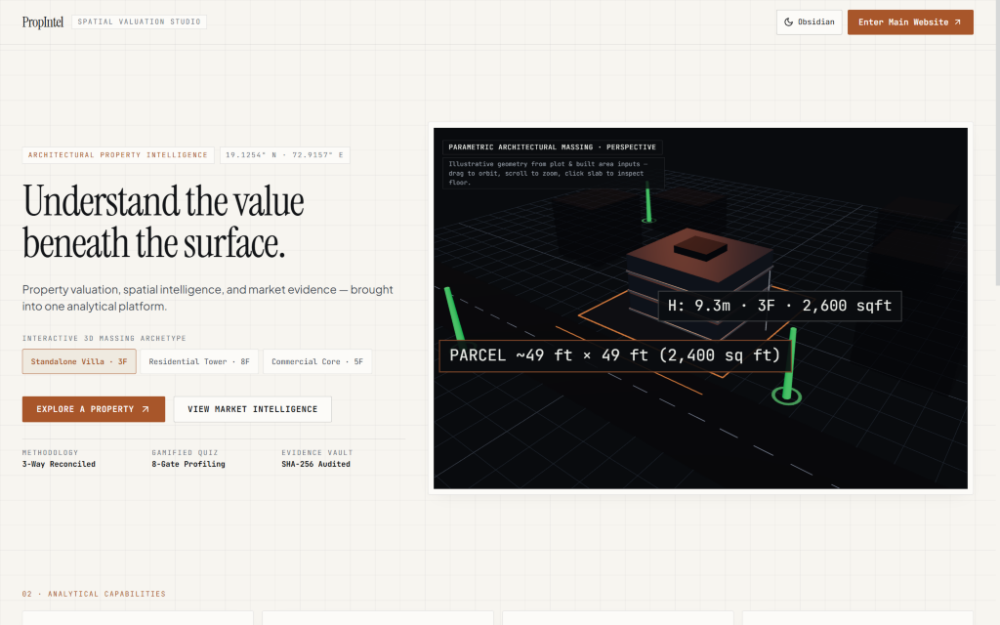
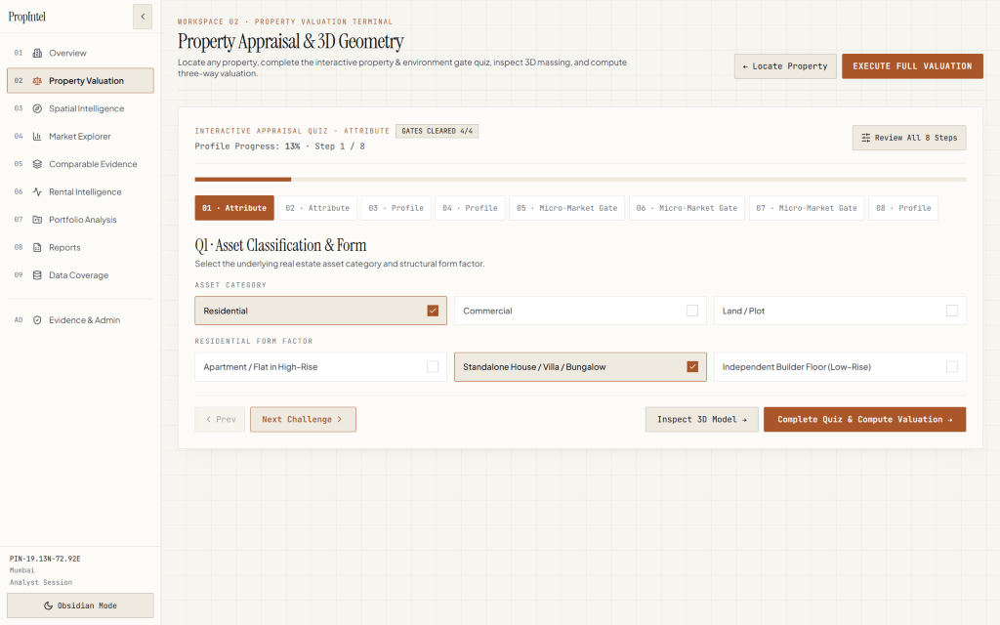
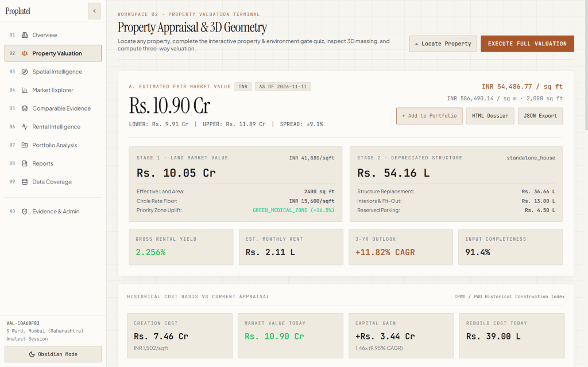

# Propertiesvaluation — PropAI Property Valuation & Spatial Intelligence Platform

An architectural, evidence-oriented real estate valuation, spatial zone intelligence, rental capitalization, and ground-truth governance platform powered by **FastAPI**, **SQLAlchemy**, **XGBoost / CatBoost**, **TreeSHAP**, **React + TypeScript**, **Three.js / React Three Fiber**, and **MapLibre GL**.

---

## Presentation & Demo Walkthrough

- **Presentation Folder:** [presentation/](presentation/)
- **Guided Website Demo Video:** [presentation/PropAI_Website_Demo.mp4](presentation/PropAI_Website_Demo.mp4)
- **Valuation Engine Deep Dive Deck:** [presentation/PropAI_Valuation_Engine_DeepDive.pptx](presentation/PropAI_Valuation_Engine_DeepDive.pptx) ([Markdown Notes](presentation/PropAI_Valuation_Engine_Deep_Dive.md))
- **E-Cell IIT Bombay Deck:** [presentation/PropAI_ECellIITBombay.pptx](presentation/PropAI_ECellIITBombay.pptx)

---

## Visual Proof & Live Verification

### 1. Standalone 3D Dynamic Architectural Landing Page (`/`)
Full-screen editorial landing workspace featuring interactive Three.js / React Three Fiber parametric architectural massing (`Standalone Villa · 3F`, `Residential Tower · 8F`, `Commercial Core · 5F`), real-time parcel & height callouts (`H: 9.3m · 3F · 2,600 sqft`, `PARCEL ~49 ft × 49 ft`), Obsidian/Stone theme switcher, full parameter & 7-cluster explorer, and direct entry into the appraisal terminal.



### 2. Gamified 8-Step Property & Micro-Market Gate Quiz
Replaced static multi-field forms with an interactive 8-step quiz (`Q1 · Asset Classification & Form` through environment gates and profile inputs) paired with live gate verification (`GATES CLEARED 4/4`) and progress tracking.



### 3. Three-Way Valuation Reconciliation & Historical Cost Ledger (`S Ward, Mumbai`)
Verified live appraisal output (`Rs. 10.90 Cr`, bounds `Rs. 9.91 Cr – Rs. 11.89 Cr`, spread `±9.1%`) decomposing Stage 1 Land Market Value (`Rs. 10.05 Cr` with backend priority-zone adjustment) and Stage 2 Depreciated Structure (`Rs. 54.16 L`), gross rental yield (`2.256%`, `Rs. 2.11 L/mo`), 3-year outlook (`+11.82% CAGR`), historical CPWD/PWD creation cost basis (`Rs. 7.46 Cr` vs `Rs. 10.90 Cr`), and one-click HTML Dossier / JSON exports.



---

## Platform Architecture

1. **Multi-Specialist Valuation & Three-Way Reconciliation (`src/services/`)**
   - **`ProductionModelService`** (`src/services/production_models.py`): Serves champion trained `XGBoost` (`apartment`, `rental`) and `CatBoost` (`house`, `residential_land`, `commercial`) models. `agricultural` and `industrial` asset classes explicitly return `DATA_NOT_READY` instead of fabricating estimates.
   - **`GlobalPropertyValuationEngine`** (`src/services/valuation_engine.py`): Integrates Spatial Location Intelligence, backend-only Green Medical / Yellow Transit zone economics (`src/services/location_zones.py`), Sales Comparison, Land + Depreciated Construction Cost (`src/core/construction_cost.py`), Income Capitalization (`src/core/rental_finance.py`), Three-Way Reconciliation (`src/services/valuation_reconciliation.py`), Missing Feature Detection, Evidence Confidence Calibration, and `OutOfDistributionDetector`.
   - **Dynamic Backend Catalog (`src/services/platform_catalog.py`)**: Serves Pan-India & Global location presets (`Powai / IIT Bombay, Mumbai`, `South Mumbai`, `Hinjawadi, Pune`, `Cyber City, Gurgaon`, `Whitefield, Bengaluru`, `HITEC City, Hyderabad`, `OMR, Chennai`, `Salt Lake Sector V, Kolkata`, `Central London`, `Lower Manhattan`, and more) plus asset selectors cleanly from the backend.

2. **Immutable Evidence Vault, Verification & Provenance (`src/core/`, `src/ingestion/`)**
   - **Immutable Raw Archive (`raw_source_records`)**: Preserves verbatim payloads + deterministic SHA-256 checksums protected by ORM hooks and SQLite `BEFORE UPDATE`/`DELETE` triggers.
   - **Canonical Evidence Schema (`canonical_transactions`)**: Separates `EXECUTED_SALE_DEED`, `AGREEMENT_FOR_SALE`, `DIGITALLY_SIGNED_EC`, and `CERTIFIED_COPY_IGR`; classifies arm's-length transfers vs non-arm's-length transfers; and strictly decouples `eligible_for_ground_truth_validation` from `eligible_for_model_training`.
   - **Private Evidence Vault (`src/core/evidence_storage.py`)**: Quarantine scanning, magic-byte validation, SHA-256 verification, Indian PAN/Aadhaar/phone/email PII redaction, and RBAC read authorization outside static web roots (with automatic `/tmp` adaptation when `VERCEL` environment is detected).

3. **Frontend Spatial Workspace (`frontend/`)**
   - Built with **React 18**, **TypeScript 5.6**, **Vite 6**, **Tailwind CSS 3.4**, **Three.js / `@react-three/fiber` / `@react-three/drei`**, **MapLibre GL 4.7**, **Recharts 2.15**, and **Framer Motion 11**.
   - Includes standalone 3D landing showcase (`/`), Property Valuation & 3D Geometry (`PropertyQuizWizard`, `PropertyScene`, `ValuationSummary`, `ComparableEvidence`), Spatial Intelligence, Market Explorer, Rental Intelligence, Multi-Asset Portfolio Analysis, Downloadable Reports, Data Coverage, and Admin Evidence Review.

---

## Verified Test & Model Evaluation Proof

### Automated Test & Build Runs
All checks below were executed directly against the repository:

| Check Suite | Command | Verified Result |
|---|---|---|
| **Backend Pytest Suite** | `python -m pytest tests/ --tb=short -q` | **83 passed, 0 failed** (covers valuation, zones, canonical schema, verification state machine, ingestion, coverage, ops/reports, auth, rental E2E) |
| **Frontend Vitest Suite** | `cd frontend && npm run test` | **3 passed, 0 failed** (`App.test.tsx`: standalone 3D hero, landing-to-quiz flow, Rental & Coverage navigation) |
| **TypeScript & Vite Production Build** | `cd frontend && npm run build` | **Succeeded (0 TS errors)** — 2,960 modules bundled to `frontend/dist/` |
| **Live Browser E2E Verification** | Chromium headless walkthrough at `http://localhost:8000` | **HTTP 200 OK**, **0 console errors**, **0 uncaught page errors** across landing hero, quiz, and `Rs. 10.90 Cr` valuation |

### Registered Model Evaluation Summary (`models/training_metadata.json`)
Evaluated using **Spatially Separated Geographic Holdout** (`log1p(target_price_inr)`):

| Asset Category | Champion | Train / Holdout | Spatial Holdout MedAPE | Spatial Holdout R² | Status |
|---|---|---|---|---|---|
| `apartment` | XGBoost | 552 / 324 | 59.22% | -0.2173 | `TRAINED` |
| `house` | CatBoost | 184 / 108 | 45.07% | -0.2854 | `TRAINED` |
| `residential_land` | CatBoost | 276 / 162 | 62.47% | -0.2414 | `TRAINED` |
| `commercial` | CatBoost | 184 / 108 | 55.87% | -0.1005 | `TRAINED` |
| `rental` | XGBoost | 138 / 81 | 32.49% | 0.2664 | `TRAINED` |
| `agricultural` | — | — | — | — | `DATA NOT READY` |
| `industrial` | — | — | — | — | `DATA NOT READY` |

> **Honest Limitations:** Negative spatial holdout $R^2$ on property sales cohorts reflects sparse/heterogeneous geographic holdouts and zero synthetic leakage; live transaction databases report `INSUFFICIENT_EVIDENCE` / `INSUFFICIENT_VERIFIED_SAMPLE` below verification thresholds rather than fabricating confidence metrics.

---

## Quick Start & Deployment

### Local Development (Backend + Built Frontend)
```bash
cp .env.example .env
pip install -r requirements.txt
cd frontend && npm install && npm run build && cd ..
python -m pytest tests/ -q
python serve.py
```
Open **`http://localhost:8000`**.

### Docker Compose
```bash
docker compose up --build
```
Exposes port `8000` with healthcheck on `GET /api/health`.

### Vercel Full-Stack Deployment Config
Included in [vercel.json](vercel.json), [.vercelignore](.vercelignore), and [api/index.py](api/index.py):
- Static build: `cd frontend && npm install && npm run build` $\to$ `frontend/dist`
- API rewrite: `/api/(.*)` $\to$ `api/index.py` (FastAPI ASGI entrypoint)
- Serverless SQLite & Vault automatically relocate to `/tmp` when `VERCEL` environment variable is present.

---

## REST API Overview

| Group | Method | Endpoint | Policy |
|---|---|---|---|
| **Health & Config** | `GET` | `/api/health`, `/api/platform/config` | Public liveness & dynamic backend catalogs |
| **Valuation** | `POST` | `/api/property/location`, `/zones`, `/intelligence`, `/validate-details`, `/valuation` | Public multi-stage appraisal workflow |
| **Reports** | `GET` | `/api/property/valuation/{val_id}/report?format=html\|json` | Downloadable valuation & evidence dossier |
| **Models v1** | `POST` | `/api/v1/valuation/estimate` | Direct category model inference |
| **Rental** | `POST` / `GET` | `/api/rental/*` | Capitalization math, sensitivity, comparables |
| **Analytics & Coverage** | `GET` | `/api/analytics/data-quality`, `/eda`, `/micro-markets`, `/drivers`, `/explain`, `/seasonality`, `/coverage` | Read-only sample-gated analytics |
| **Auth** | `POST` / `GET` | `/api/auth/login`, `/api/auth/me` | Server-side scrypt check $\to$ HMAC Bearer token |
| **Ingestion & Admin** | `POST` / `GET` | `/api/ingestion/*`, `/api/admin/review-queue`, `/api/verification/transition` | **Bearer Token + RBAC Required** |
